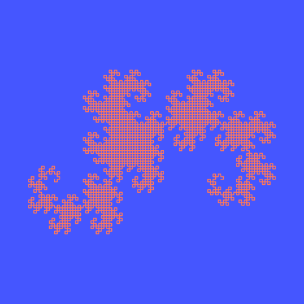
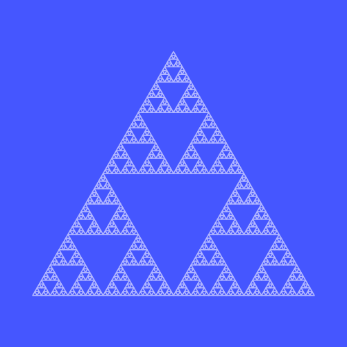
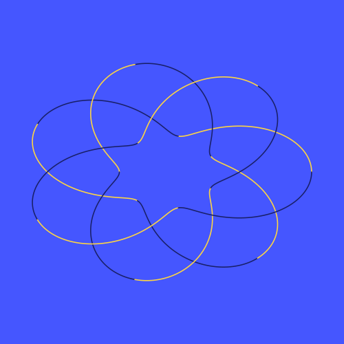

# Roboverse X · Task 5 — Extreme Geometry (participant brief)

You are handed **one** of the three challenge cards below. Write a ROS 2 Python node that reproduces the reference drawing in TurtleSim. The arena checks your run automatically; a judge reviews your code.

Canvas: 11.088889 × 11.088889 units, origin bottom-left, θ counter-clockwise from +x. A `Twist` acts for exactly 1.0 s unless replaced; `/turtle1/pose` is published every 10 ms.

---

## Challenge A · Heighway Dragon (order 12)

Draw the **Heighway dragon curve of order 12** — **4096** equal segments joined by **4095** right-angle turns.

**Construction (exact):**
1. Segment 1 points **east (+x)**.
2. Before segment *k + 1* (k = 1 … 4095) turn **90°**: **left** if `((k & -k) << 1) & k == 0`, otherwise **right**.
3. Scale uniformly so the **larger side of the bounding box is 9.0** (→ 9.000 × 5.968), and centre the bounding box on **(5.544445, 5.544445)**.

| Value | |
|---|---|
| Segment length | 0.094737 |
| Start (first vertex) | (8.054971, 4.549708) |
| Start heading | east (θ = 0) — the turtle starts here |
| Bounding box | x 1.0444 … 10.0444, y 2.5602 … 8.5287 |
| Time limit | 110 s simulated |

**Rules (all checked automatically)**
- ROS 2 Python (`rclpy`), motion only through **`/turtle1/cmd_vel`** (`geometry_msgs/Twist`).
- **No teleport** at all. **Pen down for the whole drawing** — one continuous stroke (`set_pen` may change colour, never `off`).
- Linear speed **≤ 6.0 units/s** at every 10 ms simulation step. Never touch a wall.
- Generate the path in your code. Hard-coded coordinate lists, screenshots or image tracing are not allowed (source limit **12,000 characters**).
- Stop the turtle when the drawing is complete (the program must end; the turtle must be at rest).
- Scoring tolerance: **±0.03 units**. Order and direction of drawing do not matter, missing or extra ink does.

---

## Challenge B · Sierpinski Triangle (depth 6)

Draw the **Sierpinski triangle of recursion depth 6**: an equilateral triangle of side **9.0** (bounding box **9.0 × 7.794**, base horizontal, apex up), centred on (5.544445, 5.544445).

Depth 6 = **729** smallest upward triangles of side **9/64 = 0.140625**. Draw **every edge of every smallest triangle** and nothing inside the gaps.

| Corner | Position |
|---|---|
| A (bottom-left, start) | (1.044445, 1.647331) |
| B (bottom-right) | (10.044445, 1.647331) |
| C (apex) | (5.544445, 9.441559) |

- Start pose: corner A, facing east.
- **Time limit 90 s simulated** — plan the path; you may retrace edges, but time is tight.

**Rules (all checked automatically)**
- ROS 2 Python (`rclpy`), motion only through **`/turtle1/cmd_vel`** (`geometry_msgs/Twist`).
- **No teleport** at all. **Pen down for the whole drawing** — one continuous stroke (`set_pen` may change colour, never `off`).
- Linear speed **≤ 6.0 units/s** at every 10 ms simulation step. Never touch a wall.
- Generate the path in your code. Hard-coded coordinate lists, screenshots or image tracing are not allowed (source limit **12,000 characters**).
- Stop the turtle when the drawing is complete (the program must end; the turtle must be at rest).
- Scoring tolerance: **±0.03 units**. Order and direction of drawing do not matter, missing or extra ink does.

---

## Challenge C · Torus-Knot Projection (3D-style)

Draw the planar projection of the **(3, 7) torus knot** with depth shading.

**Curve, 0 ≤ t ≤ 2π:**

`x(t) = (2 + cos 7t)·cos 3t`   `y(t) = (2 + cos 7t)·sin 3t`   `z(t) = sin 7t` (depth)

- Sample **2400** equal steps: tₖ = 2πk/2400, k = 0 … 2400 (closed polyline of 2400 segments).
- Normalise the sampled points **independently in x and y** to a **9.0 × 7.0** bounding box centred on (5.544445, 5.544445).
- **3D illusion (colour is scored):** segment k → k+1 uses **gold RGB (255, 214, 64)** when z at its mid-parameter t = 2π(k+½)/2400 is ≥ 0, else **navy RGB (25, 32, 105)**.
- Start pose: the point at t = 0 = (10.044445, 5.544445), facing east.
- **Time limit 40 s simulated.**

**Rules (all checked automatically)**
- ROS 2 Python (`rclpy`), motion only through **`/turtle1/cmd_vel`** (`geometry_msgs/Twist`).
- **No teleport** at all. **Pen down for the whole drawing** — one continuous stroke (`set_pen` may change colour, never `off`).
- Linear speed **≤ 6.0 units/s** at every 10 ms simulation step. Never touch a wall.
- Generate the path in your code. Hard-coded coordinate lists, screenshots or image tracing are not allowed (source limit **12,000 characters**).
- Stop the turtle when the drawing is complete (the program must end; the turtle must be at rest).
- Scoring tolerance: **±0.03 units**. Order and direction of drawing do not matter, missing or extra ink does.

---

## Scoring (100 points)

| Area | Points |
|---|---|
| Geometric similarity | 35 |
| Correct dimensions and proportions | 20 |
| Path continuity and completeness | 15 |
| Turtle movement precision | 15 |
| Correct completion and stopping | 10 |
| Code organisation and reliability (judge) | 5 |

SUBMIT unlocks only when every automatic check passes for the exact code you ran.
